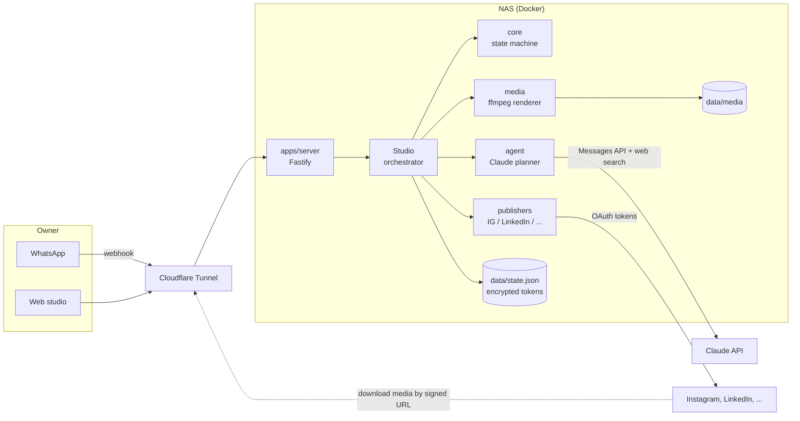
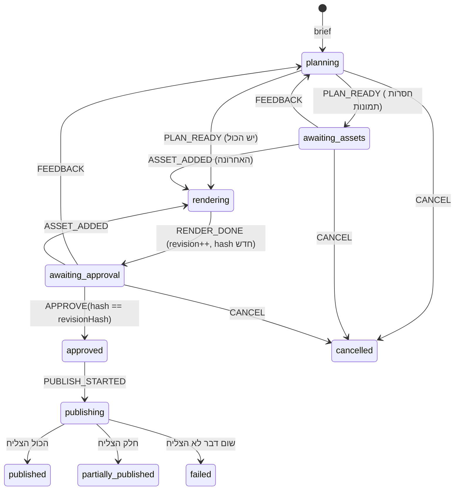

# ארכיטקטורה

## רכיבים

## מחזור החיים של טיוטה

כל שינוי מצב עובר דרך פונקציה טהורה אחת, `transition()` ב-`packages/core/src/draft.ts`. היא זורקת שגיאה על כל מעבר לא חוקי.

### למה האישור קשור ל-hash

כשהרינדור מסתיים, `computeRevisionHash` מחשב hash על כל הכיתובים, ההאשטגים, הכותרות והקישורים, ועל ה-sha256 של קבצי המדיה. כפתור האישור בוואטסאפ נושא את ה-hash הזה (`approve:<draftId>:<hash>`). אם בינתיים נשלחו הערות ונוצרה גרסה חדשה, לחיצה על כפתור ישן מחזירה "הגרסה הזו כבר לא העדכנית", ולא מפרסמת. `PUBLISH_STARTED` בודק שוב שהאישור תואם לגרסה הנוכחית.

## הזרימה בקוד

| שלב | איפה | הערות |
| --- | --- | --- |
| קבלת הודעה | `apps/server/src/app.ts` → `/webhooks/whatsapp` | בדיקת `X-Hub-Signature-256`, סינון לפי `OWNER_WHATSAPP`, הסרת כפילויות |
| הבנת הכוונה | `channels/conversation.ts` | טקסט חופשי = בריף חדש, או הערות אם יש תצוגה מקדימה פתוחה. זיהוי רשתות מהטקסט ("באינסטגרם", "ללינקדאין") |
| תכנון | `packages/agent/src/claude-planner.ts` | שלב מחקר עם `web_search`, ואז `messages.parse` עם סכמת Zod. אם חסרה רשת או שכיתוב חורג מהמגבלה: סבב תיקון אחד |
| רינדור | `packages/media/src/renderer.ts` | ffmpeg: zoompan על תמונות, drawtext עם fribidi לעברית, concat, AAC שקט |
| תצוגה מקדימה | `WhatsAppNotifier.preview` | וידאו (קישור חתום) + סיכום טקסט + 3 כפתורים |
| פרסום | `Studio.runPublish` | לכל יעד: חשבון מחובר → ולידציה → `publisher.publish` → תוצאה נשמרת מיד |

שלבים ארוכים (Claude, ffmpeg, העלאות) רצים ברקע ולא מחזיקים נעילה. כל עדכון מצב עובר דרך `Studio.update`, שמסדר קריאה-שינוי-כתיבה לכל טיוטה בתור.

## אבטחה

- **טוקנים**: AES-256-GCM לפני שהם נכתבים לדיסק (`secrets.ts`). המפתח ב-`APP_SECRET_KEY`.
- **OAuth state**: חתום ב-HMAC, תוקף 15 דקות, קשור לרשת ולבעלים.
- **מדיה**: לא חשופה. כל קישור חתום ופג תוקף (`/media/...?exp=&sig=`), כדי ש-Instagram ו-WhatsApp יוכלו להוריד בלי שהתיקייה תהיה ציבורית.
- **API**: Bearer token (`STUDIO_ADMIN_TOKEN`), השוואה timing-safe.
- **וואטסאפ**: רק המספר של הבעלים; חתימת webhook נבדקת על ה-body הגולמי.

## החלטות ופשרות

| החלטה | למה | מתי לשנות |
| --- | --- | --- |
| קובץ JSON אחד במקום DB | משתמש אחד, אפס תחזוקה על ה-NAS, גיבוי = העתקת תיקייה | כשיש יותר ממשתמש אחד → Postgres |
| עבודת רקע בתוך התהליך, בלי תור | פשוט; מספיק לנפח אישי | כשצריך retries ותזמון → BullMQ + Redis |
| ffmpeg במקום Remotion/Chromium | קל, מהיר על מעבד של NAS | טיפוגרפיה עשירה ושורות שמערבבות עברית ואנגלית → רינדור HTML (Remotion) |
| מתאמים ישירים לכל רשת | בלי עמלה חודשית, בלי צד שלישי עם הטוקנים | אם אישורי האפליקציות ברשתות נתקעים → מתאם ל-API מאוחד (ראה platforms.md) |
| TypeScript בלי build | Node 22 מריץ `.ts` ישירות (type stripping) | אף פעם, כל עוד אין decorators/enums |

